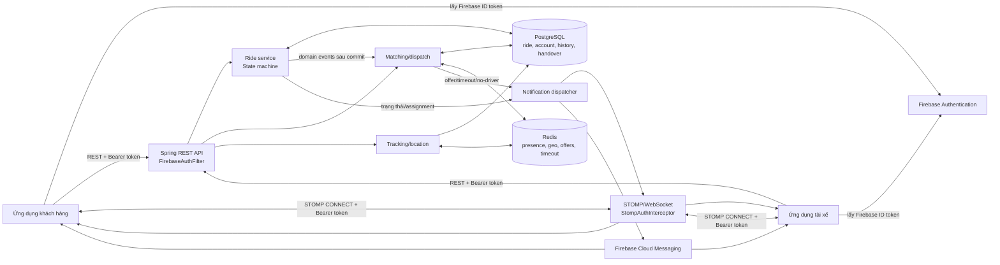
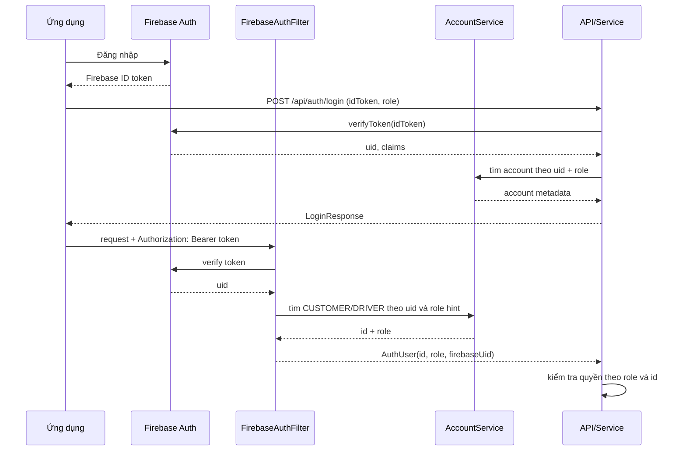
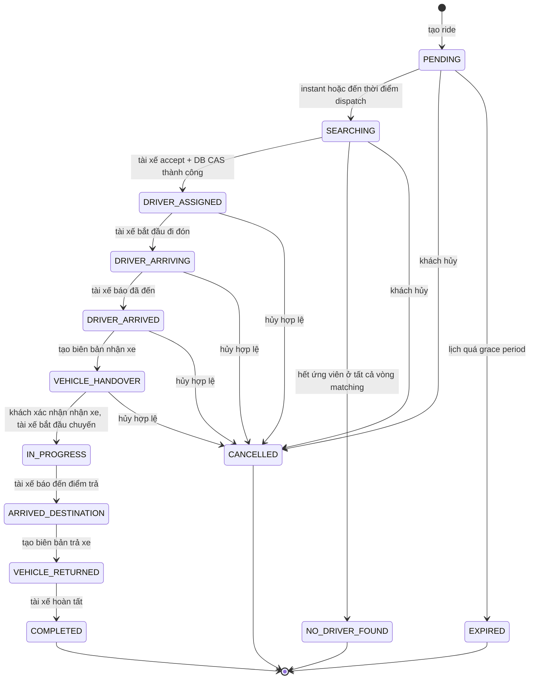
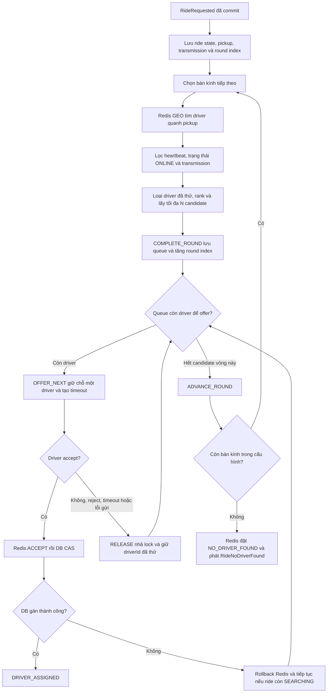
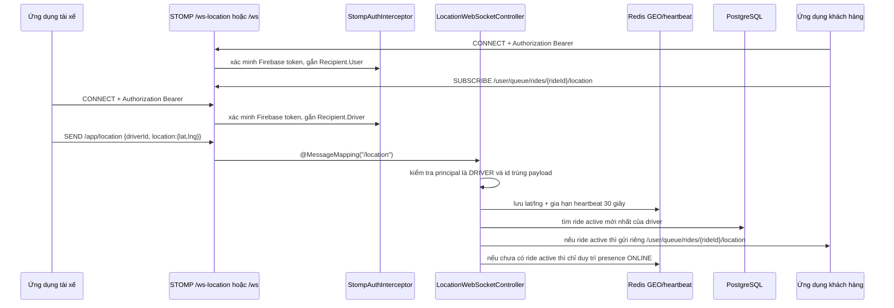

# Backend đặt xe: Ride, Matching, Tracking và Auth

Tài liệu này mô tả luồng theo code hiện tại trong repository: ai gọi API nào, dữ liệu đi qua PostgreSQL/Redis ra sao, và auth bảo vệ các luồng ride, matching, tracking như thế nào. Đây là mô tả triển khai hiện tại; các giới hạn đã biết được ghi ở cuối tài liệu.

## 1. Kiến trúc và ranh giới dữ liệu



| Thành phần | Trách nhiệm |
| --- | --- |
| Firebase Auth | Client đăng nhập và lấy Firebase ID token. Backend xác minh token; backend không tự phát hành token Firebase. |
| Auth REST filter | Xác minh token, tra account CUSTOMER/DRIVER, đưa `AuthUser(id, role, firebaseUid)` vào SecurityContext. |
| Ride | Tạo chuyến, tính báo giá, kiểm soát state transition, lưu lịch sử và biên bản bàn giao. |
| Matching | Tìm/rank tài xế, gửi offer lần lượt, nhận accept/reject và xử lý timeout. |
| Tracking | Lưu vị trí/heartbeat tài xế trong Redis, tìm tài xế gần điểm đón, chuyển vị trí chuyến đang chạy riêng cho khách. |
| PostgreSQL | Nguồn dữ liệu chuẩn cho ride, account, status history, handover và báo giá. |
| Redis | Trạng thái tạm thời: vị trí khả dụng, heartbeat, khóa offer, hàng đợi ứng viên và timeout. Redis không thay PostgreSQL làm nguồn trạng thái bền vững của ride. |
| Notification | Gửi envelope qua STOMP và/hoặc FCM theo policy của loại thông báo. |

## 2. Auth: Firebase token, role và ID

### REST

1. Client đăng nhập qua Firebase và lấy **Firebase ID token**.
2. Các API `/api/auth/**` hỗ trợ login/register/link phone. Những endpoint này là public; chúng xác minh token và trả metadata tài khoản.
3. Với API cần đăng nhập, client gửi `Authorization: Bearer <Firebase ID token>`.
4. `FirebaseAuthFilter` xác minh token, lấy Firebase `uid`, rồi tìm account trong bảng CUSTOMER và DRIVER.
5. Nếu UID có đúng một account, backend dựng principal `AuthUser(id, role, firebaseUid)`. Nếu UID có ở cả hai bảng, request cần `X-Role: CUSTOMER` hoặc `X-Role: DRIVER` (có thể dùng query `role`); nếu không tìm thấy account, request bị từ chối.
6. Các service kiểm tra **cả role và ID**. `AuthUser.id` là ID trong bảng riêng theo role: cùng một số ID có thể đại diện các account khác nhau ở hai bảng.

Ví dụ với thao tác của tài xế: cần kiểm tra `actor.role == DRIVER` **và** `ride.driverId == actor.id`. Principal hiện có `id`, không có thuộc tính `userId`.



### STOMP/WebSocket

- STOMP `CONNECT` phải có native header `Authorization: Bearer <Firebase ID token>`; interceptor xác minh token và gắn principal.
- `SUBSCRIBE` chỉ chấp nhận destination bắt đầu bằng `/user/queue/`. `SEND` yêu cầu đã xác thực.
- Token verifier STOMP tìm user trước rồi mới tìm driver. Nếu cùng Firebase UID có ở cả hai bảng, STOMP hiện phân loại thành USER; STOMP chưa có role hint như REST.
- Broker được cấu hình cho `/topic` và `/queue`, nhưng inbound guard không cho client subscribe `/topic/**`; luồng client hiện dùng `/user/queue/**`.
- Endpoint `/ws-location` cho phép HTTP handshake qua Spring Security nhưng **STOMP CONNECT vẫn phải xác thực**. `/ws` không nằm trong allowlist HTTP nên handshake cũng đi qua auth REST filter.

Ví dụ destination client dùng:

```text
Thông báo chung cho account: /user/queue/trip
Vị trí chuyến cụ thể:         /user/queue/rides/{rideId}/location
Gửi vị trí tài xế:            /app/location
```

### Vai trò và phạm vi ID

| Actor | ID được dùng | Quyền chính trong luồng này |
| --- | --- | --- |
| CUSTOMER | `users.id` | Tạo chuyến, xem chuyến của mình, hủy chuyến mình sở hữu, xác nhận biên bản nhận xe. |
| DRIVER | `drivers.id` | Bật/tắt nhận chuyến, nhận/từ chối offer, cập nhật vị trí của chính mình, cập nhật tiến độ và biên bản cho chuyến được gán. |
| SYSTEM | Không phải account đăng nhập | Bắt đầu tìm chuyến đặt lịch đến hạn, đánh dấu hết hạn hoặc không tìm thấy tài xế. |
| ADMIN | Có enum/nhánh quyền ở một số service | Luồng đăng nhập admin chưa được nối vào `AccountService`; `/api/auth` hiện chỉ tra CUSTOMER/DRIVER. Profile `postman-local` chỉ cấp quyền đọc `GET /admin/pricing-rules` trên loopback. |

## 3. Ride: tạo chuyến đến hoàn tất

### Tạo chuyến và bắt đầu tìm tài xế

`POST /rides/estimate` gọi provider báo giá, route dùng Mapbox. `POST /rides` chỉ cho CUSTOMER. Service kiểm tra địa chỉ/lịch, xác nhận xe thuộc khách hàng, lấy quote rồi lưu ride và lịch sử ban đầu `PENDING`.

- `INSTANT`: trong cùng luồng tạo, chuyển `PENDING → SEARCHING`, ghi history/status event, rồi phát `RideRequested`. Listener matching xử lý sau khi transaction commit.
- `SCHEDULED`: giữ `PENDING`; scheduler quét mỗi 30 giây. Mặc định hiện tại bắt đầu dispatch trước giờ hẹn 15 phút. Nếu đã trễ quá 30 phút so với giờ hẹn thì chuyển `EXPIRED`; nếu còn trong grace period thì chuyển `SEARCHING` và phát `RideRequested`.
- `createRide` kiểm tra một ride active hiện có cho customer trước khi tạo. Danh sách active không bao gồm `PENDING`, nên nhiều lịch hẹn chưa đến thời điểm tìm tài xế có thể cùng tồn tại.

### State machine



Mọi transition thường đi qua `RideStateMachine`: kiểm tra quyền, transition hợp lệ, điều kiện bàn giao, ghi ride và `RideStatusHistory`, rồi phát status event. Riêng assignment dùng câu UPDATE có điều kiện `status = SEARCHING` để chỉ một tài xế thắng khi có accept đồng thời.

### Bàn giao xe và kết thúc

1. Tài xế được gán gọi `POST /rides/{id}/start-arriving`, rồi `/arrived`.
2. Khi đã `DRIVER_ARRIVED`, tài xế tạo pickup report tại `/handover/pickup`; yêu cầu gồm 4–5 ảnh, tối thiểu góc trước/sau/trái/phải, cùng odometer và thông tin xe. Ride chuyển sang `VEHICLE_HANDOVER` trong cùng transaction.
3. Chủ chuyến xác nhận tại `/handover/pickup/confirm`. Chỉ sau khi report đã được xác nhận, tài xế mới có thể gọi `/start` để chuyển `IN_PROGRESS`.
4. Tài xế gọi `/arrive-destination`, tạo dropoff report tại `/handover/dropoff` (odometer không nhỏ hơn lúc nhận xe); ride sang `VEHICLE_RETURNED`.
5. Tài xế gọi `/complete`; phải có dropoff report. Ride sang `COMPLETED`, ghi `completedAt`, gán `finalFare` từ `fareEstimate` nếu chưa có, và phát event hoàn tất.

## 4. Matching: chọn, mời và gán tài xế

### Cấu hình tìm kiếm

Các giá trị được bind từ `application.properties` vào `MatchingProperties`:

```properties
matching.search-radii-km=2.0,4.0,7.0,10.0
matching.max-candidates-per-round=20
```

Danh sách bán kính phải khác rỗng, tăng dần và lớn hơn 0; `max-candidates-per-round` phải lớn hơn 0. Có thể cấp các giá trị khác nhau theo môi trường mà không sửa mã nguồn. Ứng dụng đọc cấu hình khi khởi động; thay đổi cấu hình cần khởi động lại service để có hiệu lực.



Các bước hiện tại:

1. Driver phải bật `PUT /driver/me/availability` với `online=true`; tài khoản cần có license đã xác minh và không bị flagged. Driver chỉ thực sự có thể được chọn khi Redis có location/heartbeat mới.
2. Khi nhận `RideRequested` sau commit, matching lưu state `SEARCHING`, thông tin pickup/transmission và con trỏ vòng tìm trong Redis. Vòng đầu dùng bán kính đầu tiên trong `matching.search-radii-km`.
3. Mỗi vòng truy vấn Redis GEO theo bán kính hiện tại, gần trước; `LocationService` chỉ trả driver có heartbeat còn hạn. Matching nạp hồ sơ DB, chỉ giữ driver `ONLINE` phù hợp transmission; với xe số sàn, license class `B1` bị loại. `vehicleType` hiện có trong event/ride nhưng chưa được dùng để lọc tài xế.
4. Điểm rank = `rating × 10 + min(yearsOfExperience × 2, 10) − min(distanceKm / radiusKm, 1) × 10`. Nếu thiếu rating, dùng `5.0`; nếu thiếu kinh nghiệm, dùng `0`. Điểm cao hơn được thử trước. Chuẩn hóa khoảng cách theo bán kính của vòng để điểm rating vẫn có ảnh hưởng ở vòng xa.
5. Sau khi loại ID đã nằm trong tập Redis `ride:{id}:rejected`, matching xếp tối đa `max-candidates-per-round` ứng viên vào queue. Tập này được ghi ngay khi `OFFER_NEXT` giữ chỗ offer và tiếp tục được giữ khi driver reject, hết giờ hoặc không gửi được; vòng sau dùng tập đó để không thử lại driver đã offer.
6. `OFFER_NEXT` chỉ giữ chỗ một driver tại một thời điểm: kiểm tra heartbeat, trạng thái `ONLINE`, lock/current ride, đặt `currentDriver`, trạng thái `OFFERED`, lock 20 giây và timeout offer 15 giây. Driver có 15 giây để accept/reject; timeout task quét mỗi giây.
7. Chỉ khi queue của vòng hiện tại hết, matching mới gọi `ADVANCE_ROUND` và tìm bán kính tiếp theo. `COMPLETE_ROUND` lưu queue và tăng con trỏ vòng một cách nguyên tử. Khi đã hết bán kính cuối mà không có driver được nhận, Redis chuyển sang `NO_DRIVER_FOUND` và phát `RideNoDriverFound`; listener cập nhật PostgreSQL nếu ride vẫn `SEARCHING`, rồi thông báo khách.
8. Accept trước hết cập nhật Redis bằng Lua (kiểm tra đúng current driver và deadline), sau đó `RideAssignmentService` dùng DB CAS `SEARCHING → DRIVER_ASSIGNED`. Nếu DB không nhận assignment, Redis được rollback và matching tiếp tục nếu ride còn `SEARCHING`; nếu DB đã commit nhưng listener ném lỗi, service đọc lại DB để nhận diện assignment đã thành công.
9. Khách hủy khi còn tìm tài xế: DB state machine chuyển `CANCELLED`, listener dọn candidate/current offer trong Redis và gửi đóng offer nếu có. Khi ride kết thúc/hủy sau assignment, driver được giải phóng khỏi trạng thái bận.

Redis TTL chính: offer 15 giây; driver lock 20 giây; heartbeat 30 giây; ride state và tập driver đã thử 24 giờ; candidate list 1 giờ. Candidate/offer/presence là trạng thái tạm; status ride chính thức vẫn nằm trong PostgreSQL. Redis GEO dùng khoảng cách đường chim bay; hiện chưa có bước gọi Mapbox Matrix để xếp lại theo ETA đường thực tế.

## 5. Tracking: presence, vị trí và chia sẻ với khách



- Payload location dùng `GeoPoint(lat, lng)`; Redis GEO ghi theo thứ tự `(longitude, latitude)`.
- `/api/location/geocode` và `/api/location/directions` dùng Mapbox; `/api/location/nearby-drivers` là endpoint ADMIN-only.
- Driver heartbeat hết hạn sau 30 giây; job dọn driver stale khỏi GEO chạy mỗi 60 giây.
- Vị trí chuyến được gửi riêng theo principal customer của ride. Client không được subscribe `/topic/**` qua inbound guard.
- Để nhận notification chung, app cũng cần subscribe `/user/queue/trip`. STOMP notification hiện xem recipient online khi session subscribe destination này; presence cho vị trí chuyến là một destination riêng.

Ví dụ body gửi vị trí:

```json
{
  "driverId": 42,
  "location": { "lat": 10.7769, "lng": 106.7009 }
}
```

## 6. Event và kênh thông báo

Ride status, assignment, no-driver, cancellation và completion phát các event để notification/listener xử lý sau khi dữ liệu ride được ghi. Matching cũng phát offer/timeout events. Policy hiện tại:

| Loại | Delivery policy |
| --- | --- |
| `RIDE_OFFER`, `RIDE_ASSIGNED` | WebSocket trước; nếu recipient không reachable thì thử FCM. |
| `OFFER_EXPIRED`, `OFFER_CANCELLED`, `RIDE_UPDATED` | Chỉ WebSocket. |
| `RIDE_NO_DRIVER`, `RIDE_CANCELLED`, `RIDE_COMPLETED` | Gửi WebSocket và thử FCM. |

WebSocket envelope được gửi tới `/user/queue/trip`; vị trí live được gửi tới `/user/queue/rides/{rideId}/location`. Các loại payload và policy là hành vi hiện tại của server, client nên xử lý theo `type` thay vì dựa vào một loại thông báo duy nhất.

## 7. API liên quan

Các route ride/matching/driver không có prefix `/api`; auth, map và một số admin route có prefix như bảng dưới.

| Method | Route | Mục đích / quyền chính |
| --- | --- | --- |
| `POST` | `/api/auth/login` | Xác minh Firebase ID token và lấy account theo role. |
| `POST` | `/api/auth/google`, `/api/auth/facebook` | Đăng nhập provider; tài khoản mới/thiếu phone có thể cần link phone. |
| `POST` | `/api/auth/register`, `/api/auth/link-phone` | Đăng ký hoặc liên kết số điện thoại đã xác minh. |
| `POST` | `/rides/estimate` | Báo giá chuyến; cần đăng nhập. |
| `POST` | `/rides` | Tạo ride; CUSTOMER. |
| `GET` | `/rides`, `/rides/{id}` | Danh sách cá nhân/chi tiết ride; quyền theo owner hoặc assigned driver. |
| `POST` | `/rides/{id}/cancel` | Hủy theo state machine; customer sở hữu hoặc driver được gán tùy trạng thái. |
| `POST` | `/rides/{id}/start-arriving`, `/rides/{id}/arrived`, `/rides/{id}/start`, `/rides/{id}/arrive-destination`, `/rides/{id}/complete` | Driver được gán cập nhật tiến độ. |
| `POST` | `/rides/{id}/handover/pickup` | Driver được gán tạo biên bản nhận xe. |
| `POST` | `/rides/{id}/handover/pickup/confirm` | Customer sở hữu chuyến xác nhận nhận xe. |
| `POST` | `/rides/{id}/handover/dropoff` | Driver được gán tạo biên bản trả xe. |
| `PUT` | `/driver/me/availability` | Driver bật/tắt nhận chuyến. |
| `POST` | `/offers/{rideId}/accept`, `/offers/{rideId}/reject` | Driver nhận/từ chối offer. |
| `GET` | `/api/location/geocode`, `/api/location/directions` | Geocode và route qua Mapbox; cần đăng nhập. |
| `GET` | `/api/location/nearby-drivers` | Tra cứu tài xế gần; ADMIN. |
| `GET` | `/admin/rides`, `/admin/pricing-rules` | API quản trị ride/pricing; yêu cầu ADMIN ở cấu hình thường. |
| STOMP | `/ws-location`, `/ws` | Kết nối WebSocket/STOMP; vẫn cần bearer token ở STOMP CONNECT. |

## 8. Cấu hình chạy local

Yêu cầu Java 21, PostgreSQL, Redis và các credential của Firebase/Mapbox/Cloudinary. `application.properties` import `.env` tùy chọn và đọc các biến:

```dotenv
DB_POSTGRESQL_URI=jdbc:postgresql://localhost:5432/app_dat_xe
DB_POSTGRESQL_USERNAME=postgres
DB_POSTGRESQL_PASSWORD=...
DB_REDIS_URI=redis://localhost:6379
MAPBOX_PUBLIC_TOKEN=...
CLOUDINARY_CLOUD_NAME=...
CLOUDINARY_API_KEY=...
CLOUDINARY_API_SECRET=...
```

Firebase config hiện yêu cầu classpath resource `src/main/resources/firebase-service-account.json`. Cung cấp credential qua cơ chế secret/local phù hợp và không commit service-account key thật. JPA đặt `ddl-auto=validate`, do đó database phải có schema tương thích trước khi chạy.

Chạy từ PowerShell:

```powershell
.\gradlew.bat bootRun
```

Linux/macOS:

```bash
./gradlew bootRun
```

Có thể thay các chính sách lịch bằng properties `ride.scheduling.dispatch-lead-minutes`, `ride.scheduling.expire-grace-minutes`, `ride.scheduling.poll-interval-ms`. Giá trị repository hiện tại lần lượt là 15, 30 và 30000 ms.

## 9. Giới hạn hiện tại cần biết

- Matching chỉ lọc `transmission` và trạng thái tài xế; `vehicleType` chưa được so khớp với phương tiện/tài xế.
- `RideRequested` được xử lý bằng Spring in-process event sau commit. Chưa có outbox hoặc reconciliation job cho ride `SEARCHING` bị bỏ dở nếu process/Redis lỗi đúng thời điểm; cần cơ chế bù để đảm bảo dispatch bền vững khi vận hành production.
- Kiểm tra active ride của customer là `exists` trước khi insert, chưa phải constraint/lock chống hai request tạo ride đồng thời. `PENDING` scheduled rides không nằm trong active set hiện tại.
- Chính sách lịch hiện là mặc định 15 phút trước giờ hẹn và hết hạn sau 30 phút grace; đây là giá trị code/config đang chạy, chưa phải quyết định chính sách cuối cùng.
- REST auth không phân giải ADMIN từ account table hiện tại; một số API có nhánh kiểm tra ADMIN nhưng chưa có luồng cấp principal admin thông thường. `postman-local` là ngoại lệ hẹp, chỉ đọc pricing trên loopback.
- STOMP verifier chọn user trước driver nếu Firebase UID tồn tại ở cả hai bảng; cần role-aware principal nếu cho phép một UID đồng thời làm customer và driver.
- Chưa có kiểm chứng end-to-end trong tài liệu này với PostgreSQL, Redis, Firebase, FCM và Mapbox cùng hoạt động; cấu hình local phải được xác nhận ở môi trường chạy thực tế.

