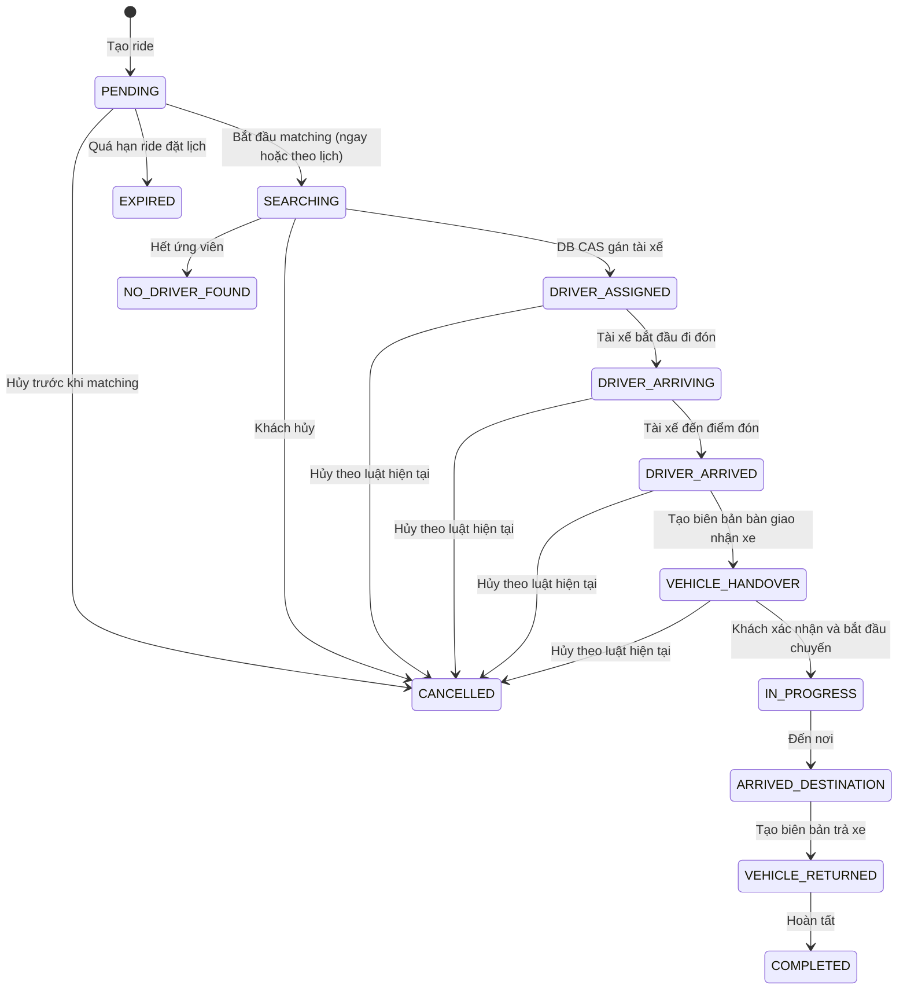

# Ride, matching và tracking — checklist triển khai

## Checklist

- [x] Tạo `RestClient.Builder` bean dự phòng để `MapboxDirectionsClient` không làm ứng dụng lỗi khi khởi động.
- [x] Khi tài xế nhận offer, chỉ xác nhận thành công sau khi DB gán tài xế bằng câu lệnh compare-and-set (`SEARCHING` → `DRIVER_ASSIGNED`).
- [x] Bù trạng thái Redis nếu DB không gán được; nếu ride vẫn `SEARCHING`, chuyển offer cho tài xế kế tiếp.
- [x] Kiểm tra deadline ngay trong Lua `ACCEPT`, tránh nhận offer đã quá hạn khi worker timeout chạy chậm.
- [x] Giữ danh sách ứng viên đến khi DB gán thành công; không để timeout/reject cũ giải phóng một offer đã nhận.
- [x] Khi hết ứng viên, chuyển ride trong DB từ `SEARCHING` sang `NO_DRIVER_FOUND` và để luồng notification báo khách.
- [x] Bổ sung scheduler xử lý ride đặt lịch; hai mốc dispatch/expire đọc từ cấu hình.
- [ ] Chốt chính sách thời điểm dispatch và expire theo mốc bạn muốn; hiện giá trị tạm thời là 15 phút trước / 30 phút sau.
- [x] Chặn khách tạo ride mới khi đã có ride đang hoạt động.
- [x] Ghi đúng vai trò USER/DRIVER/SYSTEM trong event trạng thái; chuyển lý do hủy sang notification.
- [x] Giới hạn API xem vị trí các tài xế gần đó cho ADMIN và sửa thứ tự latitude/longitude.
- [x] Chỉ gửi vị trí tài xế tới hàng đợi riêng của khách thuộc ride đang chạy; bỏ broadcast toàn cục và điểm reroute hard-code.
- [x] Giữ nguyên luồng hủy/giải phóng tài xế hiện có.
- [x] Build `compileKotlin` thành công với JDK 21.
- [ ] Lọc tài xế phù hợp theo `vehicleType`/hạng bằng lái. `RideRequested` có `vehicleType` nhưng matching hiện chỉ truyền `transmission`; entity `Driver` chưa có loại xe và rule hiện tại chỉ loại B1 với số sàn.
- [ ] Có retry/reconciliation cho ride `SEARCHING` khi dispatch event hoặc Redis lỗi sau DB commit. Repository đã có truy vấn ride cũ, nhưng hiện chưa có worker phục hồi event bị mất.
- [ ] Làm active-ride guard an toàn khi hai yêu cầu tạo ride chạy đồng thời; hiện chỉ có truy vấn `exists` trước khi insert.
- [ ] Chạy smoke test tích hợp với PostgreSQL, Redis, một tài khoản khách và một tài khoản tài xế.

## Chính sách ride đặt lịch (giá trị tạm thời)

Các giá trị mặc định ở `application.properties`:

```properties
ride.scheduling.dispatch-lead-minutes=15
ride.scheduling.expire-grace-minutes=30
ride.scheduling.poll-interval-ms=30000
```

Scheduler quét ride `PENDING`: trong cửa sổ dispatch trước giờ đón thì chuyển sang `SEARCHING` và phát yêu cầu matching; nếu đã quá giờ đón hơn thời gian expire thì chuyển sang `EXPIRED`. Mặc định hiện tại là 15/30 phút để luồng có thể chạy; hai giá trị này chưa được chốt vì bạn nói sẽ nhập chính sách khác.

## Sơ đồ hoạt động chi tiết

```mermaid
sequenceDiagram
    autonumber
    actor Customer as Khách hàng
    participant API as Ride API / RideService
    participant DB as PostgreSQL / RideStateMachine
    participant Scheduler as ScheduledRideScheduler
    participant Match as RideDispatchService
    participant Geo as Redis GEO + driver status
    participant Driver as Ứng dụng tài xế
    participant Offer as Redis offer / timeout
    participant Track as WebSocket tracking

    Customer->>API: Tạo ride
    API->>API: Kiểm tra role, lịch, xe sở hữu, ride đang hoạt động
    API->>DB: Lưu ride PENDING + lịch sử
    alt Ride tức thời
        API->>DB: PENDING → SEARCHING
        API-->>Match: RideRequested (sau commit)
    else Ride đặt lịch
        Note over Scheduler: Quét mỗi 30 giây; mặc định bắt đầu trước 15 phút
        Scheduler->>DB: Tìm ride PENDING đến cửa sổ dispatch
        alt Đã quá scheduledAt hơn 30 phút
            Scheduler->>DB: PENDING → EXPIRED
            DB-->>Customer: Notification EXPIRED
        else Đến cửa sổ dispatch
            Scheduler->>DB: PENDING → SEARCHING
            Scheduler-->>Match: RideRequested (sau commit)
        end
    end

    Match->>Geo: Tìm tài xế gần điểm đón, lọc trạng thái và hộp số
    alt Không có tài xế phù hợp
        Match-->>DB: RideNoDriverFound
        DB->>DB: SEARCHING → NO_DRIVER_FOUND
        DB-->>Customer: Notification hết tài xế
    else Có tài xế phù hợp
        Match->>Offer: Tạo queue, reserve tài xế đầu tiên, đặt deadline
        Offer-->>Driver: Offer có expiresAt
        loop Từ chối, hết hạn, hoặc gửi offer thất bại
            Driver-->>Offer: Reject / không phản hồi
            Offer->>Offer: Giải phóng tài xế, loại khỏi queue hiện tại
            Offer->>Match: Chọn tài xế tiếp theo
            Match-->>Driver: Offer tiếp theo
        end
        Driver->>Offer: Accept
        Offer->>Offer: Lua kiểm tra SEARCHING, đúng tài xế, deadline còn hạn
        alt Offer hợp lệ
            Offer->>DB: CAS gán tài xế nếu DB vẫn SEARCHING
            alt DB gán thành công
                DB->>DB: Lưu DRIVER_ASSIGNED + lịch sử + event
                DB-->>Customer: Notification tài xế đã nhận
                Offer->>Offer: Xóa queue ứng viên còn lại
            else DB không gán được / ride đã đổi trạng thái
                Offer->>Offer: Hoàn tác Redis theo trạng thái DB
                opt DB vẫn SEARCHING
                    Offer->>Match: Gửi offer cho ứng viên kế tiếp
                end
            end
        else Offer hết hạn hoặc không còn là offer hiện tại
            Offer-->>Driver: Accept bị từ chối
        end
    end

    opt Ride đã gán tài xế
        Driver->>DB: Cập nhật DRIVER_ARRIVING → DRIVER_ARRIVED → VEHICLE_HANDOVER
        Driver->>DB: START_TRIP → ARRIVED_DESTINATION → VEHICLE_RETURNED → COMPLETED
        DB-->>Customer: Notification trạng thái đúng theo actor
        Driver->>Track: Gửi vị trí của chính tài khoản tài xế
        Track->>Geo: Lưu vị trí/heartbeat
        Track-->>Customer: /user/queue/rides/{rideId}/location
        Note over Track,Customer: Không broadcast vị trí sang khách hàng khác
    end

    opt Khách hoặc tài xế hủy theo luật trạng thái
        Customer->>DB: CANCEL + lý do
        DB->>DB: Lưu CANCELLED + actor + lý do
        DB-->>Offer: Thu hồi offer / giải phóng tài xế sau commit
        DB-->>Customer: Notification hủy chuyến
    end
```

## Luồng trạng thái ride



## Phạm vi chưa được xác nhận

Phần compile đã thành công. Smoke test tích hợp còn mở vì cần chạy ứng dụng cùng PostgreSQL, Redis và cấu hình Mapbox thật. Chính sách thời gian đặt lịch cũng còn chờ bạn chốt; hiện 15/30 phút chỉ là giá trị cấu hình tạm thời.

Rà soát mã lần hai bổ sung ba khoảng trống còn lại vào checklist: rule ghép tài xế theo loại xe/hạng bằng lái chưa đủ dữ liệu và chưa được áp dụng; chưa có cơ chế phục hồi `SEARCHING` nếu sự kiện dispatch bị mất sau commit; và kiểm tra ride đang hoạt động chưa được khóa nguyên tử cho hai request đồng thời. Vì vậy luồng chính đã kết nối ở mức code, nhưng checklist chưa hoàn tất để xác nhận vận hành production.
